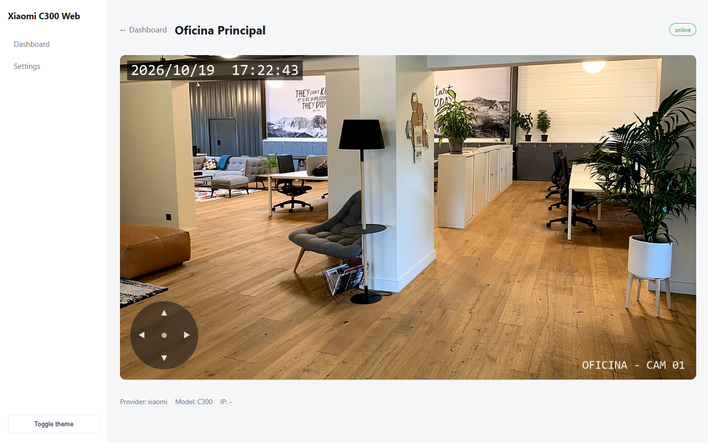
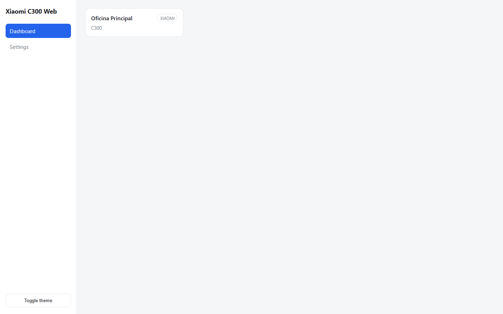
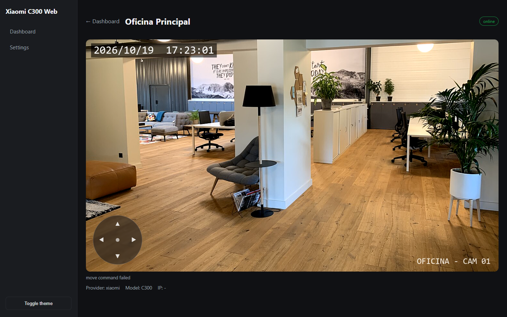

# Xiaomi C300 Web — Caso de estudio

Sitio de presentación del proyecto **xiaomi-c300-web**: una plataforma web que muestra en tiempo real el video de una cámara Xiaomi Smart Camera C300 en el navegador, sin depender de la app Mi Home.

**Código fuente:** [alvarosiles/xiaomi-c300-web-source](https://github.com/alvarosiles/xiaomi-c300-web-source)



---

## Resumen

| | |
|---|---|
| **Rol** | Diseño y desarrollo full stack |
| **Dominio** | IoT · Streaming de video en tiempo real |
| **Stack** | Node.js · Express · JavaScript · Web Components · go2rtc · FFmpeg |
| **Estado** | Prototipo funcional, verificado con una cámara C300 real |

## Problema

La C300 usa un protocolo P2P propietario (miss/CS2), no expone RTSP y recibe su IP por DHCP. Además, el códec y el transporte por defecto no funcionan de forma fiable en navegadores de escritorio.

## Solución

Arquitectura en tres capas que separa el protocolo propietario de la experiencia de usuario:

```
Navegador (SPA, MSE) ──HTTP/WS──► Backend Express ──REST/WS──► go2rtc ──P2P/TCP──► Cámara C300
                                   API · registro · proxy        │
                                   resolución de IP              └──► Nube Xiaomi (IP por did)
```

- **Frontend:** SPA en JavaScript sin framework; reproductor `video-rtc` en modo MSE.
- **Backend:** API REST, proxy HTTP/WebSocket hacia el motor y tarea programada que mantiene actualizada la IP de la cámara.
- **Motor:** go2rtc implementa el protocolo de Xiaomi y la conversión a formatos que entiende el navegador.

Patrones: Strategy (`VideoSource`), Gateway/Adapter (`StreamGateway`), Registry (`CameraManager`) e inyección de dependencias manual.

## Decisiones técnicas

| ID | Decisión | Motivo | Compromiso |
|---|---|---|---|
| ADR-01 | Delegar el protocolo en go2rtc | Protocolo propietario y cambiante | Dependencia de un proceso externo |
| ADR-02 | Forzar transporte TCP | Por UDP la cámara no enviaba video | Algo más de latencia |
| ADR-03 | MSE sobre WebSocket en lugar de WebRTC | ICE inestable con varias interfaces de red | Latencia algo mayor que WebRTC |
| ADR-04 | Resolver la IP por identidad (`did`) vía nube | El DHCP mueve la cámara | Requiere conectividad con la nube |
| ADR-05 | Proxy del motor detrás del backend | Evitar CORS y unificar el origen | El backend queda en la ruta del video |

## Funcionalidades

| Funcionalidad | Estado |
|---|---|
| Video en vivo en el navegador | Operativo |
| Resolución automática de IP y reconfiguración en caliente | Operativo |
| Estado online/offline y health check | Operativo |
| Dashboard multi-cámara y tema claro/oscuro | Operativo |
| Control pan/tilt | Pendiente (protocolo sin documentar) |
| Configuración persistente y autenticación | Pendiente |

## API

| Método | Ruta | Propósito |
|---|---|---|
| GET | `/api/cameras` | Flota de cámaras |
| GET | `/api/cameras/:id` | Detalle de una cámara |
| GET | `/api/streams/:id` | Endpoints de video (WS, MP4, MJPEG) |
| GET | `/api/status/:id` | Estado online/offline |
| POST | `/api/cameras/:id/move` | Pan/tilt |
| GET | `/api/system/health` | Salud del backend y del motor |

## Capturas

| Dashboard | Visor en vivo | Tema oscuro + pan/tilt |
|---|---|---|
|  |  |  |

Las capturas muestran la aplicación real en ejecución con una cámara de demostración, una foto de oficina CC0 emitida como stream, para no exponer video privado.

## Seguridad

Pensado para una LAN de confianza. Ya implementa escape de HTML, validación de entrada y errores controlados. Pendiente: autenticación, protección de la API del motor y gestión de secretos fuera del repositorio.

## Roadmap

1. Gestión de secretos.
2. Autenticación.
3. Control pan/tilt.
4. Configuración persistente.
5. Pruebas automatizadas, CI y Docker Compose.

## Estructura de este repositorio

```
.
├── index.html          # Página del caso de estudio (GitHub Pages)
├── README.md
└── assets/img/         # Capturas de la aplicación
```

Para publicarlo: **Settings → Pages → Deploy from a branch → `main` / root**.

---

© 2026 Alvaro Siles Estrada · MIT · Imagen de demostración: “Work & Wall, espace de coworking à Neyron”, Wikimedia Commons (CC0).
